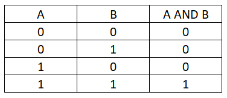
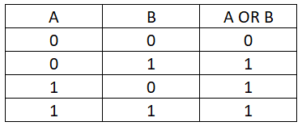
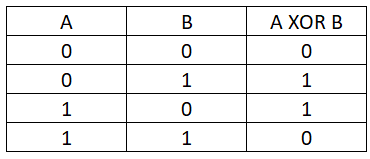
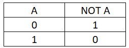

# Quelques notions mathématiques

## Arithmétique
### Le module
Le modulo est une opération qui permet de retourner le reste de la division euclidienne de `a` par `b` :
$a = b*k + r \Leftrightarrow a = r \pmod b$

Exemple : $16 = 5*3 + 1 \Leftrightarrow 16 = 1 \pmod 5$

Dans le cas où `r` est à 0, on dit que `b` divise `a`.

Quelques liens :
- https://www.annales2maths.com/terminale-divisibilite-dans-z-et-congruences/
- https://www.youtube.com/watch?v=BByKm1u16qs 

### Le PGCD
Le Plus Grand Diviseur Commun se calcule entre 2 nombres. Comme le nom l'indique, c'est le plus grand diviseur commun aux 2 nombres. 

Exemple : $PGCD(18,16) = 2$ car $`18 \equiv 3*3*2`$ et $`16 \equiv 2*2*2*2`$.

$PGCD(101,50) = 1$ car $`101 \equiv 101`$ et $`50 \equiv 2*5*5`$, 1 est le seul diviseur commun. Dans ce cas, on dit que 101 et 50 sont premiers entre eux.

Quelques liens :
- https://fr.wikipedia.org/wiki/Plus_grand_commun_diviseur
- https://www.annales2maths.com/terminale-pgcd-et-applications/
- https://www.youtube.com/watch?v=TWYv8aKKYls

### Les nombres premiers
Un nombre est dit premier si il n'est divisible que par 1 et par lui-même.
```
2,3,5,7,11,13...
```
Les nombres premiers possède de nombreuses propriétés spécifiques très intéressantes.

Quelques liens :
- https://fr.wikipedia.org/wiki/Nombre_premier
- https://www.annales2maths.com/terminale-cours-nombres-premiers/
- https://www.youtube.com/watch?v=BhH8zE9e4Tw 

### Les puissances
$a^n$ correspond à `a` multiplié par lui-même `n` fois. En python : `a**n`.

Exemple : $2^5 = 2*2*2*2*2 = 32$

Règles à connaître :
- $a^m * a^n = a^{m+n}$ (exemple : $2^3 * 2^4 = 8*16 = 128 = 2^7$)
- $a^m / a^n = a^{m-n}$ (exemple : $2^5 / 2^3 = 32/8 = 4 = 2^2$)
- $(a^m)^n = a^{m*n}$ (exemple : $(2^3)^2 = 8^2 = 64 = 2^6$)
- $a^0 = 1$ et $a^{-n} = 1/a^n$

Attention, il n'y a pas de règle pour l'addition : $2^3 + 2^4 = 24 \neq 2^7$.

Quelques liens :
- https://fr.wikipedia.org/wiki/Puissance_d%27un_nombre

### Les puissances modulaires
Pour calculer $a^b \pmod n$ avec de grands nombres, on utilise :
```py
pow(a,b,n)
```
C'est bien plus rapide que `a**b % n`, car le résultat est réduit modulo `n` à chaque étape.

Les règles des puissances restent vraies modulo `n`. De plus, si $G^Q = 1 \pmod P$, on peut réduire les exposants modulo `Q`.

Exemple : $2^3 = 8 = 1 \pmod 7$, donc $2^{10} = 2^{10 \bmod 3} = 2^1 = 2 \pmod 7$.

Le petit théorème de Fermat dit que si `p` est premier (et `a` pas multiple de `p`) : $a^{p-1} = 1 \pmod p$.

Quelques liens :
- https://fr.wikipedia.org/wiki/Exponentiation_modulaire
- https://fr.wikipedia.org/wiki/Petit_th%C3%A9or%C3%A8me_de_Fermat

### L'inverse modulaire
`v` est l'inverse modulaire de `u` modulo `n` si $u*v = 1 \pmod n \Leftrightarrow u = v^{-1} \pmod n$.

En python, on peut le calculer ainsi :
```py
u = pow(v,-1,n)
```
Cette opération est notamment utilisé dans le chiffrement RSA.

Quelques liens : 
- https://fr.wikipedia.org/wiki/Inverse_modulaire
- https://www.youtube.com/watch?v=NGSdl7y4wdI


### Le logarithme discret
Connaissant $h = G^v \pmod P$, retrouver `v` s'appelle le logarithme discret. C'est très difficile quand `v` peut être grand, mais si `v` est petit, on peut tester toutes les valeurs une à une.

Exemple : on cherche `v` tel que $3^v = 5 \pmod 7$. On teste $3^1 = 3$, $3^2 = 2$, $3^3 = 6$, $3^4 = 4$, $3^5 = 5$ donc $v = 5$.

Quelques liens :
- https://fr.wikipedia.org/wiki/Logarithme_discret

## Algèbre linéaire
### Le produit scalaire
Le produit scalaire de deux listes de nombres $x = (x_1, ..., x_n)$ et $y = (y_1, ..., y_n)$ est :
$\langle x,y \rangle = x_1*y_1 + x_2*y_2 + ... + x_n*y_n$

Exemple : $x = (3,1,4)$ et $y = (2,0,5)$ donnent $3*2 + 1*0 + 4*5 = 26$.

En python :
```py
sum(x[i]*y[i] for i in range(len(x)))
```

Quelques liens :
- https://fr.wikipedia.org/wiki/Produit_scalaire

### Les systèmes d'équations
Un système, c'est plusieurs équations à résoudre en même temps.

Exemple : $a + b = 10$ et $a - b = 4$. En additionnant les deux : $2a = 14$, donc $a = 7$ puis $b = 3$.

Il faut en général autant d'équations (différentes) que d'inconnues. $a + b = 5$ et $2a + 2b = 10$ ne suffisent pas : la 2e équation est la 1re multipliée par 2.

Pour beaucoup d'inconnues, on peut utiliser python :
```py
from sympy import symbols, solve
a, b = symbols("a b")
solve([a + b - 10, a - b - 4], [a, b])
```

Quelques liens :
- https://fr.wikipedia.org/wiki/Syst%C3%A8me_d%27%C3%A9quations_lin%C3%A9aires

## Logique
### Représentation binaire
Nous utilisons communément la base 10 pour calculer ou bien communiquer. Cependant, il existe d'autres bases.

En base 10, le nombre 346 peut se décomposer ainsi : 
$`346 \equiv 3*100 + 4*10 + 6*1 \equiv 3*10^2 + 4*10^1 + 6*10^0`$

Ainsi, en base 2 (ou binaire), c'est la même chose : 
$`(1011)_2 \equiv 1*2^3 + 0*2^2 + 1*2^1 + 1*2^0 \equiv 8 + 2 + 1 = 11`$

Cette représentation est utilisée par les ordinateurs.

Il existe également les bases 16, 8... qui se décomposent de la même manière.

Quelques liens :
- https://fr.wikipedia.org/wiki/Syst%C3%A8me_binaire

### Le code ASCII
Chaque caractère est représenté par un nombre, selon la table ASCII. Par exemple `A` = 65, `a` = 97, `0` = 48.

En python :
```py
ord("A") # 65
chr(97)  # 'a'
```

Quelques liens :
- https://fr.wikipedia.org/wiki/American_Standard_Code_for_Information_Interchange

### Les opérations logiques

En mathématiques, on utilise généralement des opérations telles que l'addition (+), la multiplication (x)... Il existe également des opérations logiques. Le résultat des opérations logiques est toujours constitué d'un de ces 2 éléments {VRAI, FAUX} ou {1,0} appelés valeurs de vérité.

Il est possible d'établir des tables de vérité.

- Opération AND :

Le résultat S est à 1 (VRAI) seulement si A et B sont également à 1.


- Opération OR :

Le résultat S est à 1 (VRAI) seulement si A, B, ou les deux sont à 1.


- Opération XOR :

Le résultat S est à 1 (VRAI) seulement si A et B sont la négation de l'autre (1,0) ou (0,1).


- Opération NOT :

Le résultat S est la négation de la valeur de A.



Quelques liens :
- https://fr.wikipedia.org/wiki/Table_de_v%C3%A9rit%C3%A9
- https://fr.wikipedia.org/wiki/Alg%C3%A8bre_de_Boole_(logique)